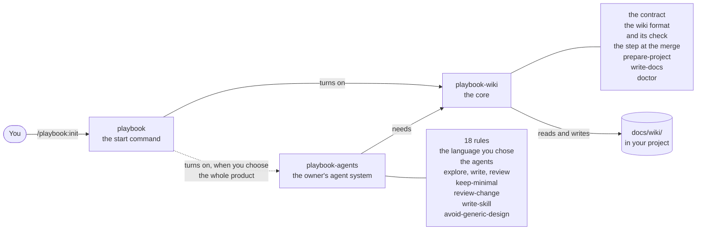
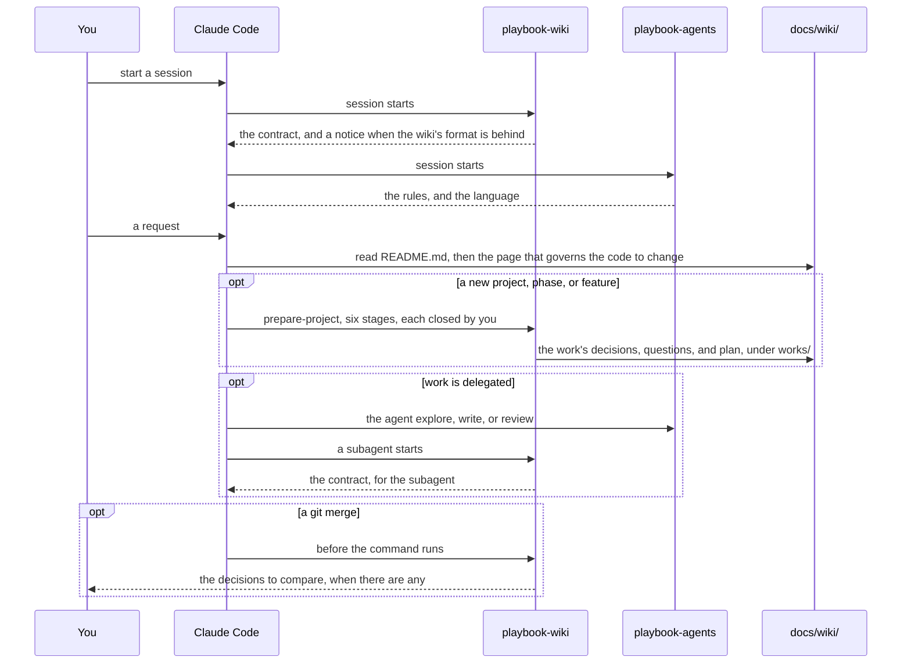

# playbook

A Claude Code product for building software with an AI coding agent, shared as it is: use it, copy it, or adapt it under the [MIT License](LICENSE). Issues and pull requests are welcome; see [CONTRIBUTING.md](CONTRIBUTING.md).

It keeps a project's definitions and decisions in a wiki inside the project's repository, so every person and every agent on the project works from the same source of truth. In this repository, "the owner" means the person who maintains the product.

It is three plugins in one marketplace:

| Plugin | For | Holds |
|--------|-----|-------|
| `playbook` | Starting the product | Only the command `/playbook:init`. Nothing else loads until you run it |
| `playbook-wiki` | Everyone who works on a project | The contract an agent follows, printed at session start; the format of a project's wiki and its check; a step before a `git merge` that shows the decisions to compare; and three skills: `prepare-project`, `write-docs`, and `doctor`, which only you start (`/playbook-wiki:doctor`) |
| `playbook-agents` | The owner's way of working, for whoever wants it | 18 working rules, printed at session start; the agents `explore`, `write`, and `review`, with the model of each in `plugins/playbook-agents/models.conf`; and four skills: `keep-minimal`, `review-change`, `write-skill`, and `avoid-generic-design`. It needs `playbook-wiki` |

You can use the wiki alone with your own agent setup, or the whole product.

**Status:** the work in progress is under [docs/wiki/works/](docs/wiki/works/); start at [docs/wiki/README.md](docs/wiki/README.md).

## How it works

How the three plugins relate. `/playbook:init` turns the others on; nothing of the product loads before it.



What each plugin does during a session. The steps inside a box run only when the case arises.



The hooks and modules behind each step are in [docs/wiki/03-technology/architecture.md](docs/wiki/03-technology/architecture.md).

## Needs

`playbook-agents` uses these tools and does not install them. Install each one in Claude Code yourself; `playbook-wiki` alone needs none of them, only git. The decisions are in [docs/wiki/decisions.md](docs/wiki/decisions.md).

| Tool | Used for | Decision |
|------|----------|----------|
| Engram | Memory across sessions. Rule R23 says what belongs in it | D25, D28 |
| CodeGraph | Questions about code structure. Rule R22 says when to use it | D25, D28 |
| `context7` | An MCP server the agent reaches when it needs the official documentation of a library or a version. No rule or skill names it | D90, D97 |

## Install

### From GitHub, in Claude Code

```sh
claude plugin marketplace add andresfrei/playbook
claude plugin install playbook@playbook --scope user
```

Then start a new Claude Code session inside a repository, and run:

```text
/playbook:init
```

It asks two questions: the wiki alone or the whole product, and this repository or every project. For the whole product it also asks the language the agent talks to you in, and tells you which other plugins are on and whether you have a global `CLAUDE.md`, because two agent setups in one session collide. It lists the skills you already have that do the same job as one it turns on, and asks what to do with each. Then a script turns the plugins on with Claude Code's own commands and prints each one. What it turned on is used from the next session.

Run `/playbook:init` again to change what is on, in that repository or in every project. It writes in no `CLAUDE.md`.

### With an agent

Paste this prompt into a Claude Code session:

```text
Install the playbook for Claude Code from https://github.com/andresfrei/playbook.
Run `claude plugin marketplace add andresfrei/playbook`, then
`claude plugin install playbook@playbook --scope user`, then `claude plugin list`,
and confirm that playbook@playbook is enabled and show its version.
Change no other setting. Then read the "Needs" section of the repository's README.md
and tell me which of Engram, CodeGraph, and context7 I am missing. Do not install
them unless I ask. Tell me to start a new session and run /playbook:init.
```

### Updates

Claude Code installs a copy of the latest release. Automatic updates are off by default for this marketplace, so update by hand when a new release is out:

```sh
claude plugin marketplace update playbook
claude plugin update playbook@playbook
```

Then update each of `playbook-wiki@playbook` and `playbook-agents@playbook` that `claude plugin list` shows, with `--scope local` from inside a repository where it was turned on for that repository only.

A release reaches you only when its version changes; the releases and their tags are on GitHub. How versions are made is in [CONTRIBUTING.md](CONTRIBUTING.md#releases).

**From version 1.** Version 2 splits the old plugin `playbook` into three. After the update, `playbook` holds only the start command, so your rules, skills, and agents are gone until you run `/playbook:init` once, in a new session, and choose the whole product for every project.

### From a local clone, in Claude Code

To change the plugins, or to load every commit as it is made:

```sh
claude plugin marketplace add /path/to/this/clone
claude plugin install playbook@playbook --scope user
```

Then run `/playbook:init` as above. The plugins are read in place from the clone: a change to the files under `plugins/` applies to the next session, or to an open one after `/reload-plugins`, with no reinstall. Whatever is checked out in the clone is what every session loads. The source for this behaviour is in [docs/wiki/03-technology/installation.md](docs/wiki/03-technology/installation.md).

### Remove it from Claude Code

Uninstall each plugin that `claude plugin list` shows, in this order, with the scope it lists: add `--scope local`, from inside the repository, for one that `/playbook:init` turned on for that repository only.

```sh
claude plugin uninstall playbook-agents@playbook
claude plugin uninstall playbook-wiki@playbook
claude plugin uninstall playbook@playbook
claude plugin marketplace remove playbook
```

## Layout

| Path | Content |
|------|---------|
| `docs/wiki/` | This repository's own wiki: what is decided, what is open, and the work in progress |
| `CLAUDE.md` | Instructions for an agent that works in this repository |
| `.github/` | `CODEOWNERS`, and the templates for issues and pull requests |
| `LICENSE`, `CONTRIBUTING.md`, `SECURITY.md` | The licence, how to contribute, how to report a vulnerability |
| `.claude-plugin/marketplace.json` | Makes this repository a Claude Code marketplace |
| `plugins/` | The three plugins. `playbook-wiki` holds the contract, the format of a wiki and its check, the step before a merge, the wiki skills, their hooks, and their evaluation cases; `playbook-agents` holds the rules file, the other skills, the agents, `models.conf`, and their evaluation cases; `playbook` holds the start command and its script |
| `scripts/` | Checks for whoever maintains the plugin, and the script that sets the agents' models |

## Checks

```sh
sh scripts/verify.sh             # manifests, format, size limits, and agent models
sh scripts/verify_test.sh        # tests of the scripts
shellcheck scripts/*.sh plugins/*/*.sh plugins/*/hooks/*.sh plugins/*/skills/*/scripts/*.sh
```

To change the model or the effort of an agent, edit its line in `plugins/playbook-agents/models.conf`, then run:

```sh
sh scripts/set-models.sh
```

The script writes the values into `plugins/playbook-agents/agents/*.md`. Do not edit the `model` or `effort` lines in `plugins/playbook-agents/agents/*.md` by hand: `verify.sh` fails when they differ from `plugins/playbook-agents/models.conf`.

Evaluation cases call the model and are billed to your account, so run them by hand, before a change to a skill is accepted:

```sh
# one skill
claude plugin eval plugins/playbook-agents --tag write-skill --ablation none --max-cost-usd 1 --no-publish
# the whole suite, one plugin at a time
claude plugin eval plugins/playbook-wiki --scaffold --ablation none --max-cost-usd 2 --no-publish -j 3
claude plugin eval plugins/playbook-agents --ablation none --max-cost-usd 3 --no-publish -j 3
```

`--no-publish` keeps the report on this machine. Each skill has two cases under `plugins/playbook-wiki/evals/` or `plugins/playbook-agents/evals/`: one request that must load it and one that must not. `prepare-project` has two more: a request that starts a new phase, and one that starts a work in a repository with a wiki. That last case builds its repository with a script, `fixture.sh`, which runs only with `--scaffold`.

`verify.sh` needs the `claude` command. The limits it enforces are in [docs/wiki/01-product/style-guide.md](docs/wiki/01-product/style-guide.md).

Start at [docs/wiki/README.md](docs/wiki/README.md). The wiki is the source of truth for what this repository is, what is decided, and what is still open.
