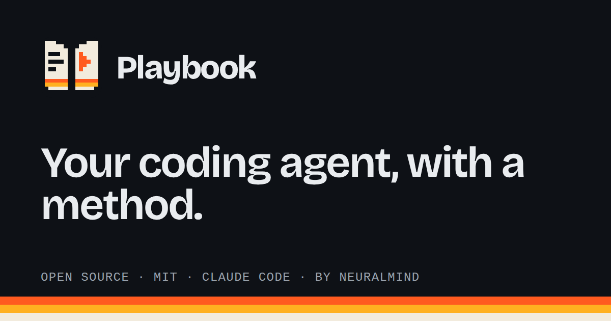

[](https://playbook.neuralmind.lat/)

# Playbook

[](https://github.com/andresfrei/playbook/releases)
[](LICENSE)

**[playbook.neuralmind.lat](https://playbook.neuralmind.lat/)** · Claude Code · by [NeuralMind](https://neuralmind.lat/)

Playbook is a free Claude Code plugin that helps you build fast without losing track. You decide what the software should do; Claude writes it down in your repository with your words, builds from it, and turns its repeated mistakes into project rules.

It adds only what Claude Code does not already do. Writing stays in your session, memory is Claude Code's auto memory, and parallel work is `/batch`.

## How a change goes

1. **Define.** `/playbook:define` names the type of change and runs only the steps it needs:

   | Type of change | Steps |
   |----------------|-------|
   | Small change | None: Claude just does it |
   | Feature on your current technology | Define |
   | Feature that adds or replaces a technology | Define, Technology, Skills |
   | New project | Define, Technology, Skills, and Design when it has an interface |

   It asks one question at a time, checks each technology in its current documentation, and writes a spec with how to check it. You accept the spec once.
2. **Build.** In your session, on the model you choose with `/model`.
3. **Close.** `/playbook:close` runs the spec's check, has a read-only `reviewer` read a risky change, and proposes one line for each mistake that happened twice: for `CLAUDE.md`, `.claude/rules/`, or a skill. You accept each line or not.
4. **Release.** `/playbook:release` sets the version and drafts the notes. Push, pull requests, merges, and releases always ask you first.

Everything lives in `docs/wiki/`: the product, each work's spec, and its decisions with who decided and their words.

## Install

```sh
claude plugin marketplace add andresfrei/playbook
claude plugin install playbook@playbook
```

Start a new session. To make searches cheaper, copy [`plugins/playbook/extras/Explore.md`](plugins/playbook/extras/Explore.md) to `~/.claude/agents/`.

To keep Claude from reading secrets, add deny rules to `.claude/settings.json`:

```json
{ "permissions": { "deny": ["Read(./.env)", "Read(./.env.*)", "Read(./secrets/**)"] } }
```

### From 4.x

Version 5 replaces the three plugins with one. Uninstall the old ones, then install `playbook`:

```sh
claude plugin uninstall playbook-agents@playbook
claude plugin uninstall playbook-wiki@playbook
claude plugin marketplace update playbook
claude plugin install playbook@playbook
```

A wiki of version 4 keeps working: the check reads its decisions as they are.

## Documentation

- [What is new](https://github.com/andresfrei/playbook/releases): the notes of every release.
- [The project wiki](docs/wiki/README.md): this repository builds Playbook with Playbook.

## Contributing

Issues and pull requests are welcome. Read the [contributing guide](CONTRIBUTING.md) first, and report vulnerabilities as [SECURITY.md](SECURITY.md) says.

Playbook is available under the [MIT License](LICENSE).
