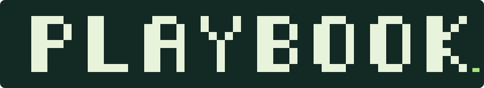
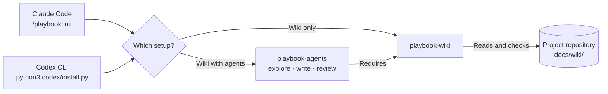
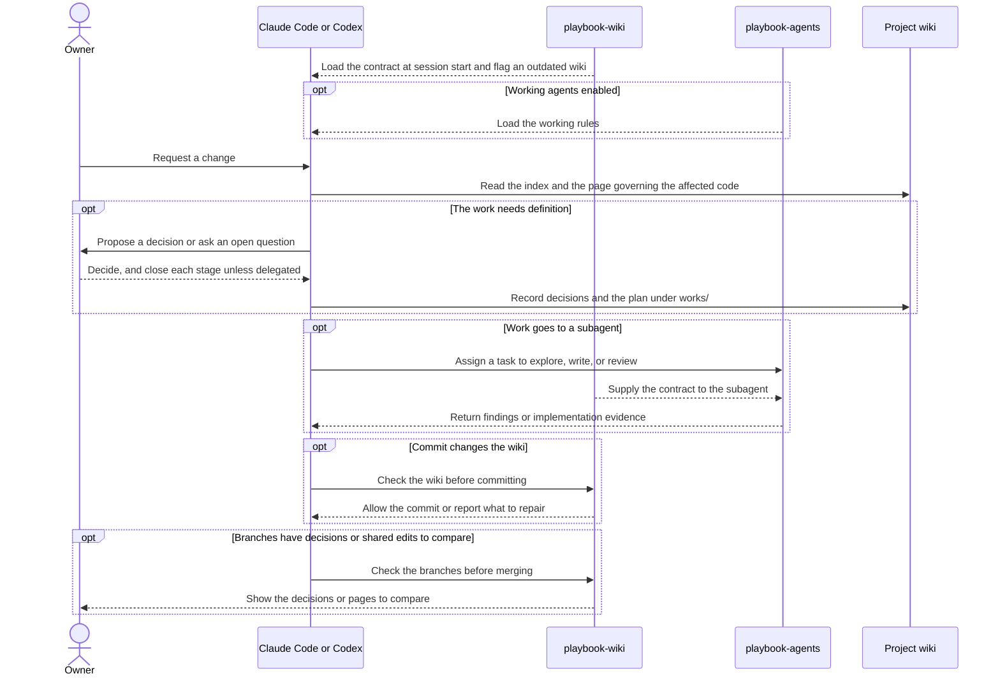

# 

Playbook is a set of plugins for building software with a coding agent in Claude Code or Codex CLI. The developer decides what the software should do. The agent records those decisions in the project's Git-backed wiki, uses them to implement changes, and reports how it checked the result. A teammate starting a fresh session can see what was agreed, why it changed, and which question to pick up next.

## Ask your agent to install Playbook

Copy the prompt for your client into a session. You choose whether to use the wiki alone or add the working agents.

### Claude Code prompt

```text
Install Playbook for Claude Code from https://github.com/andresfrei/playbook.
Add its marketplace with `claude plugin marketplace add andresfrei/playbook`
if it is missing. Run `claude plugin install playbook@playbook --scope user`.
Use `claude plugin list` to confirm the plugin is enabled and tell me its version.
Then tell me how to start a fresh Claude Code session in my project and run
/playbook:init so I can choose the components and scope.
```

### Codex CLI prompt

```text
Install Playbook for Codex CLI from https://github.com/andresfrei/playbook.
Ask me which setup I want: 1 for the wiki only, or 2 for the wiki and agents.
Use my local Playbook checkout if it contains codex/install.py. Otherwise,
clone the repository into a fresh directory. From the checkout root, run
`python3 codex/install.py` and supply my choice when it prompts.
Report what was installed and any existing profiles the installer kept.
Show me which hooks to review in /hooks, then how to start a fresh Codex
session in my project.
```

## Choose your plugins

Playbook is opt-in. You can use the wiki with your own agent setup or add the working agents. Each plugin guide shows its workflow.

| Plugin | When to choose it |
|--------|-------------------|
| [`playbook` — setup](plugins/playbook/README.md) | Use the optional `/playbook:init` wizard in Claude Code to choose components and scope. Codex users make their selection in the installer. |
| [`playbook-wiki` — project memory](plugins/playbook-wiki/README.md) | Choose this on its own to keep decisions in Git, prepare work in stages, and check wiki changes before commits and merges. |
| [`playbook-agents` — working rules and agents](plugins/playbook-agents/README.md) | Add this to the wiki when you want the working rules, specialized skills and the `explore`, `write`, and `review` roles. It requires `playbook-wiki`. |



## How a change moves through Playbook

1. **Read the project.** At session start, the wiki plugin gives the agent its working contract. Before editing a file, the agent opens `docs/wiki/README.md` and follows the entry for the code it will touch. Shared wiki pages describe the product as it stands.
2. **Define the work.** For a new project, phase, or feature that needs definition, the agent opens a work folder under `docs/wiki/works/`. It distinguishes proposals from open questions and records each decision with the owner's words. The work moves through six stages: wiki and product definition, technology, skills, design system, plan, and execution. The owner closes each one, or a delegation does; a stage can be closed as inapplicable.
3. **Build and verify.** The plan divides implementation into units. Each has an observable ending condition: a passing check, for example, or the owner's judgement on a document. The agent records the evidence and updates the work's README with what comes next. A small, already-defined change can be handled directly.
4. **Commit and merge.** A hook checks changes to a current-format wiki before commit and reports broken links or invalid records. Before merging, the agent brings accepted definitions into the shared pages. If both branches added decisions or changed the same shared page, Playbook lists what the owner and agent need to compare.
5. **Ask less over time.** Each decision records its kind and how the owner answered. When a work closes, a kind the owner keeps accepting as recommended is proposed as a delegation: the agent then decides it without asking and says so in one line. A "yes but" or a "no" on a delegated decision leads to a proposal to revoke it. A new product definition, a push or merge into the main branch, an action outside the repository, and spending beyond a written ceiling are never delegated.

### What happens during a session



## Set up your client

| Client | Start here |
|--------|------------|
| Claude Code | Install the marketplace and run `/playbook:init` to choose your setup. [Claude Code guide](docs/claude-code.md) |
| Codex CLI | From a local clone, run `python3 codex/install.py`, choose your setup, and review the hooks in `/hooks`. [Codex CLI guide](codex/README.md) |

## Explore this repository

This repository contains the plugins and uses Playbook for its own development. For a concrete example, follow the [Codex support work](docs/wiki/works/codex-support/README.md) from the owner's decisions through model trials, the installer design, and the implementation plan.

Start with the [project wiki](docs/wiki/README.md). Its page table connects product definitions to the code they govern. Then follow the part relevant to your task:

| To understand | Read |
|---------------|------|
| What an agent must do, and what it writes in the wiki | [Working contract](plugins/playbook-wiki/contract.md) and [wiki format](plugins/playbook-wiki/format.md) |
| Where the behaviour is implemented | [Wiki plugin](plugins/playbook-wiki/), [working agents](plugins/playbook-agents/), and [Codex adaptation](codex/) |
| Why a change was made and how it was verified | The relevant [work folder](docs/wiki/works/), starting with its README |
| How to test or contribute a change | [Contributing guide](CONTRIBUTING.md) |

Playbook is available under the [MIT License](LICENSE).
