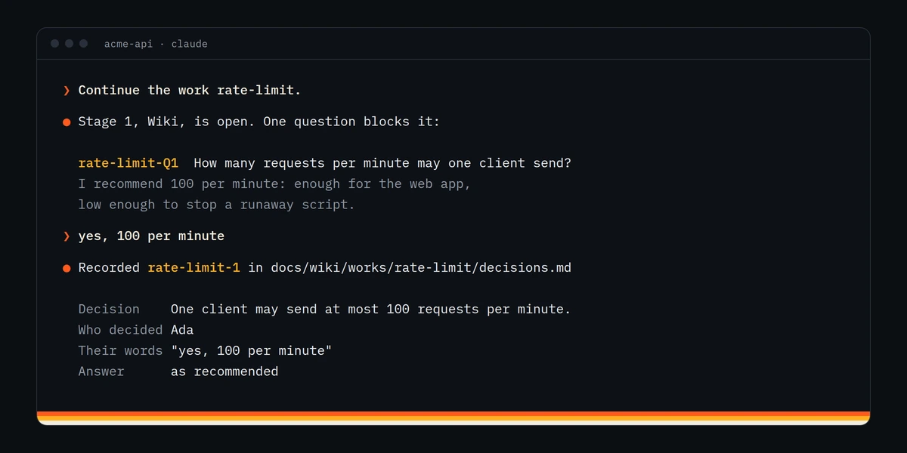

[](https://playbook.neuralmind.lat/)

# Playbook

[](https://github.com/andresfrei/playbook/releases)
[](LICENSE)

**[playbook.neuralmind.lat](https://playbook.neuralmind.lat/)** · Claude Code · Codex CLI · by [NeuralMind](https://neuralmind.lat/)

Playbook is a set of free plugins for Claude Code and Codex CLI. You decide what the software should do; the agent records each decision in your repository's wiki, builds from it, shows how it checked the result, and turns repeated mistakes into rules.



## Agents forget. Your repository should not.

- **Decisions vanish in the chat.** What you agreed with the agent lives in a session that ends. Next week nobody knows why the code is the way it is.
- **Every session starts from zero.** A teammate, or the agent itself tomorrow, cannot see what was decided, what changed, or which question is still open.
- **The same mistakes come back.** Reviews catch the same kind of bug again and again, because nothing turns a lesson into a rule the agent follows.

## Six stages before any code. You close each one.

Every new feature or phase is a work with its own folder in `docs/wiki/`. The agent proposes, asks one question at a time, and records your answer word for word.

| Stage | What gets decided |
|-------|-------------------|
| 1. Wiki | What the product must do and must not do, who uses it, and every open question |
| 2. Technology | The stack, the limits, and what each choice costs, checked against current docs |
| 3. Skills | Which agent skills the work needs, and which ones exist already |
| 4. Design system | Tokens, components, and patterns, before a single screen is built |
| 5. Plan | Units of work, each with the paths it touches and how it will be accepted |
| 6. Execution | The agent builds unit by unit, records the evidence, and asks you to accept |

## Repeated mistakes become rules

A review agent reads every risky change from a fresh context. Each defect it finds is stored as evidence under a kind of mistake. When three reviews hit the same kind, Playbook proposes one rule, and the agents that write and review code get it every time they start.

**review finds a defect** → **it is stored as evidence** → **three hits on one kind** → **a rule every agent follows**

## Three plugins

Take the wiki alone, or add the team. `playbook-agents` requires `playbook-wiki`.

| Plugin | What it gives you |
|--------|-------------------|
| [`playbook`](plugins/playbook/README.md) | The setup wizard of Claude Code, `/playbook:init`: choose the components and their scope. In Codex CLI, the installer asks instead |
| [`playbook-wiki`](plugins/playbook-wiki/README.md) | Project memory: decisions kept in Git, each work prepared in six stages, checks on the wiki before commits and merges |
| [`playbook-agents`](plugins/playbook-agents/README.md) | A working team: `explore` maps code, `write` builds, `review` reviews; in Claude Code, `classify` stores findings as evidence. Plus working rules and skills |

## Install

Paste one prompt into a session and your agent does the rest. In Claude Code, then run `/playbook:init` in your project; in Codex CLI, the installer asks which setup you want.

### Claude Code prompt

<details>
<summary>Show the prompt</summary>

```text
Install Playbook for Claude Code from https://github.com/andresfrei/playbook.
Add its marketplace with `claude plugin marketplace add andresfrei/playbook`
if it is missing. Run `claude plugin install playbook@playbook --scope user`.
Use `claude plugin list` to confirm the plugin is enabled and tell me its version.
Then tell me how to start a fresh Claude Code session in my project and run
/playbook:init so I can choose the components and scope.
```

</details>

### Codex CLI prompt

<details>
<summary>Show the prompt</summary>

```text
Install Playbook for Codex CLI from https://github.com/andresfrei/playbook.
Ask me which setup I want: 1 for the wiki only, or 2 for the wiki and agents.
Use my local Playbook checkout if it contains codex/install.py. Otherwise,
clone the repository into a fresh directory. From the checkout root, run
`python3 codex/install.py` and supply my choice when it prompts.
Report what was installed and any existing profiles the installer kept.
Show me which hooks to review in /hooks, then how to start a fresh Codex
session in my project.
```

</details>

### Or by hand

Claude Code:

```sh
claude plugin marketplace add andresfrei/playbook
claude plugin install playbook@playbook --scope user
```

Then start a fresh session in your project and run `/playbook:init`.

Codex CLI, from a clone of this repository:

```sh
python3 codex/install.py --check
python3 codex/install.py
```

Choose wiki only or wiki and agents, then review the hooks in `/hooks`.

## Documentation

- [How Playbook works](docs/how-it-works.md): how a change moves from a request to a merge, step by step, with diagrams.
- [Claude Code guide](docs/claude-code.md) and [Codex CLI guide](codex/README.md): setup, updates, and models.
- [What is new](https://github.com/andresfrei/playbook/releases): the notes of every release.
- [The project wiki](docs/wiki/README.md): this repository builds Playbook with Playbook. Every decision is there, with the owner's words.

## Contributing

Issues and pull requests are welcome. Read the [contributing guide](CONTRIBUTING.md) first, and report vulnerabilities as [SECURITY.md](SECURITY.md) says.

Playbook is available under the [MIT License](LICENSE).
