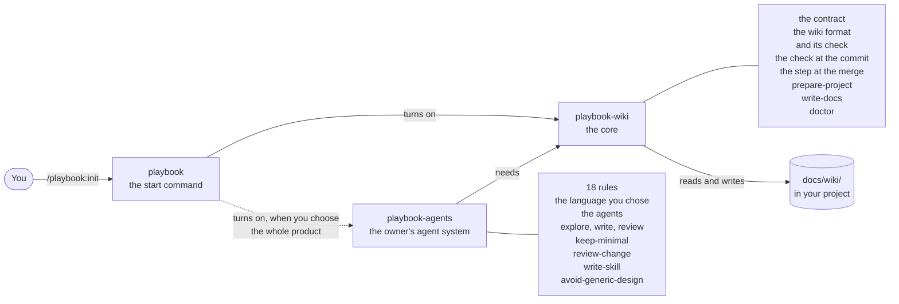
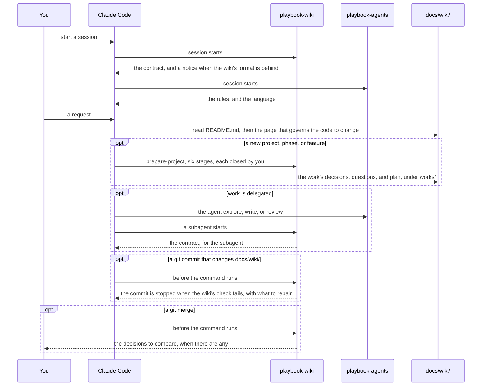

# Playbook for Claude Code

## How it works

How the three plugins relate. `/playbook:init` turns the others on; nothing of the product loads before it.



What each plugin does during a session. The steps inside a box run only when the case arises.



The hooks and modules behind each step are in [docs/wiki/03-technology/architecture.md](wiki/03-technology/architecture.md).

## Needs

`playbook-agents` uses these tools and does not install them. Install each one in Claude Code yourself; `playbook-wiki` alone needs none of them, only git. The decisions are in [docs/wiki/decisions.md](wiki/decisions.md).

| Tool | Used for | Decision |
|------|----------|----------|
| Engram | Memory across sessions. Rule R23 says what belongs in it | D25, D28 |
| CodeGraph | Questions about code structure. Rule R22 says when to use it | D25, D28 |
| `context7` | An MCP server the agent reaches when it needs the official documentation of a library or a version. No rule or skill names it | D90, D97 |

## Install

### From GitHub, in Claude Code

```sh
claude plugin marketplace add andresfrei/playbook
claude plugin install playbook@playbook --scope user
```

Then start a new Claude Code session inside a repository, and run:

```text
/playbook:init
```

It asks two questions: the wiki alone or the whole product, and this repository or every project. For the whole product it also asks the language the agent talks to you in, and tells you which other plugins are on and whether you have a global `CLAUDE.md`, because two agent setups in one session collide. It lists the skills you already have that do the same job as one it turns on, and asks what to do with each. Then a script turns the plugins on with Claude Code's own commands and prints each one. What it turned on is used from the next session.

Run `/playbook:init` again to change what is on, in that repository or in every project. It writes in no `CLAUDE.md`.

### With an agent

Copy the [Claude Code installation prompt](../README.md#claude-code-prompt) into a session. For the full setup, check the [supporting tools](#needs) as well.

### Updates

Claude Code installs a copy of the latest release. Automatic updates are off by default for this marketplace, so update by hand when a new release is out:

```sh
claude plugin marketplace update playbook
claude plugin update playbook@playbook
```

Then update each of `playbook-wiki@playbook` and `playbook-agents@playbook` that `claude plugin list` shows, with `--scope local` from inside a repository where it was turned on for that repository only.

A release reaches you only when its version changes; the releases and their tags are on GitHub. How versions are made is in [CONTRIBUTING.md](../CONTRIBUTING.md#releases).

**From version 1.** Version 2 splits the old plugin `playbook` into three. After the update, `playbook` holds only the start command, so your rules, skills, and agents are gone until you run `/playbook:init` once, in a new session, and choose the whole product for every project.

### From a local clone, in Claude Code

To change the plugins, or to load every commit as it is made:

```sh
claude plugin marketplace add /path/to/this/clone
claude plugin install playbook@playbook --scope user
```

Then run `/playbook:init` as above. The plugins are read in place from the clone: a change to the files under `plugins/` applies to the next session, or to an open one after `/reload-plugins`, with no reinstall. Whatever is checked out in the clone is what every session loads. The source for this behaviour is in [docs/wiki/03-technology/installation.md](wiki/03-technology/installation.md).

### Remove it from Claude Code

Uninstall each plugin that `claude plugin list` shows, in this order, with the scope it lists: add `--scope local`, from inside the repository, for one that `/playbook:init` turned on for that repository only.

```sh
claude plugin uninstall playbook-agents@playbook
claude plugin uninstall playbook-wiki@playbook
claude plugin uninstall playbook@playbook
claude plugin marketplace remove playbook
```
