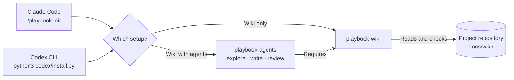
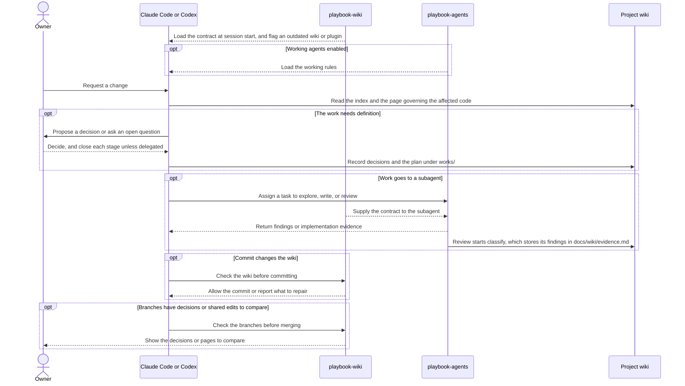

# How Playbook works

This page explains, step by step, how a change moves through Playbook, and what each plugin does during a session. For what Playbook is and how to install it, see the [README](../README.md).

## Which plugin does what

`playbook` holds the setup wizard. `playbook-wiki` keeps the project's decisions in Git. `playbook-agents` adds the working rules and agents, and requires `playbook-wiki`.

## How a change moves through Playbook

1. **Read the project.** At session start, the wiki plugin gives the agent its working contract. Before editing a file, the agent opens `docs/wiki/README.md` and follows the entry for the code it will touch. Shared wiki pages describe the product as it stands.
2. **Define the work.** For a new project, phase, or feature that needs definition, the agent opens a work folder under `docs/wiki/works/`. It distinguishes proposals from open questions and records each decision with the owner's words. The work moves through six stages: wiki and product definition, technology, skills, design system, plan, and execution. The owner closes each one, or a delegation does; a stage can be closed as inapplicable.
3. **Build and verify.** The plan divides implementation into units. Each has an observable ending condition: a passing check, for example, or the owner's judgement on a document. The agent records the evidence and updates the work's README with what comes next. A small, already-defined change can be handled directly.
4. **Commit and merge.** A hook checks changes to a current-format wiki before commit and reports broken links or invalid records. Before merging, the agent brings accepted definitions into the shared pages. If both branches added decisions or changed the same shared page, Playbook lists what the owner and agent need to compare.
5. **Ask less over time.** Each decision records its kind and how the owner answered. When a work closes, a kind the owner keeps accepting as recommended is proposed as a delegation: the agent then decides it without asking and says so in one line. A "yes but" or a "no" on a delegated decision leads to a proposal to revoke it. A new product definition, a push or merge into the main branch, an action outside the repository, and spending beyond a written ceiling are never delegated.
6. **Learn from repeated mistakes.** In Claude Code, when `review` finds defects, the `classify` agent records each one as evidence, under a kind of mistake, in `docs/wiki/evidence.md`. When three distinct reviews hit the same kind, the close of a work proposes one concrete rule that covers them, and `write` and `review` receive that rule every time they start. If the mistake comes back anyway, its evidence piles up at the rule's level and is consolidated again, so the level shows how many rules a problem has resisted. A rule that holds for any project can move up to the playbook and reach every project with the next release. To start a repository's evidence from the reviews it already had, run `/playbook-agents:seed-evidence`: it lists them from your Claude Code transcripts, you choose, and `classify` stores each one.

## What happens during a session

