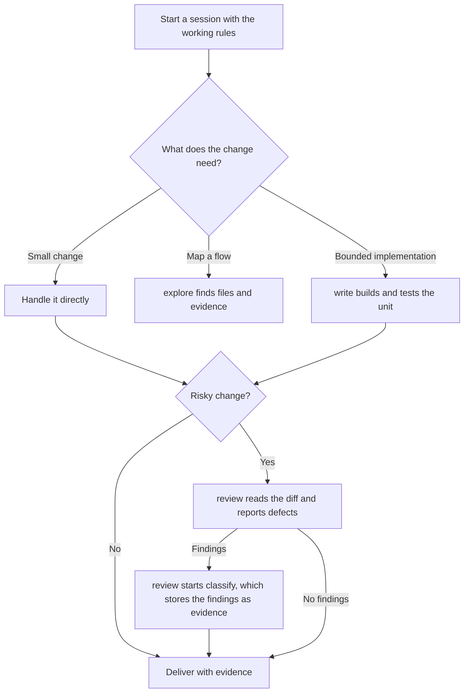

# playbook-agents

A way of working for building software with an AI coding agent: working rules the agent follows in every project, four agents to delegate to, and five skills. It is the agent system of [playbook](https://github.com/andresfrei/playbook)'s author, shared for whoever wants it.

It needs `playbook-wiki`, the core of playbook, which keeps a project's definitions and decisions in a wiki inside the repository. Installing this plugin from its marketplace installs `playbook-wiki` with it; if `claude plugin list` does not show `playbook-wiki`, install it too.

## Agent flow



## What it holds

| Part | What it does |
|------|--------------|
| [rules.md](rules.md) | The working rules: how the agent talks to you, decides, builds, delegates, and delivers |
| `explore` | An agent that maps where something lives across many files, without changing them |
| `write` | An agent that builds one bounded unit of work with its tests |
| `review` | An agent that reads a risky change in a separate context and returns findings. With findings, it starts `classify` |
| `classify` | An agent that stores each real finding of a review as a row of evidence on the project's `docs/wiki/evidence.md`, under a kind of mistake. It only adds rows |
| [evidence.sh](evidence.sh) | A script, in `sh` and `awk`, that checks the evidence page, counts distinct reviews per kind and level, prints the rules of level 2 and up, their index of kinds and when each applies, and the rule of one kind. It never writes a file |
| [evidence-rules.md](evidence-rules.md) | The playbook's general rules, learned from repeated findings: 15 of level 2 |
| [tasks.sh](tasks.sh) | A script, in `sh` and `awk`, that keeps `docs/wiki/tasks.md`: `add` records a task of a work, `count` prints each task held in 3 distinct works with no agent yet, `set-agent` writes the agent of a task or "declined", and `check` validates the page. It writes only that page |
| [seed-reviews.sh](seed-reviews.sh) | A script, in `sh` and `awk`, that lists the past reviews of a repository from your Claude Code transcripts and prints one review's text. `--from <old path>` also reads the folder of a moved repository. It never writes a file |
| [protect.sh](protect.sh) | A script, in `sh` and `awk`, that lists the secret files of a repository by name (`scan`, skipping `.git` and `node_modules`, never reading a file) and adds the rules you choose to a Claude Code settings file (`apply`): `Read` denials and sandbox read denials for secret files, `ask` rules for deleting and resetting, the sandbox on, and unsandboxed commands off. It adds only what is missing, changes no other key, and leaves a file that is not a JSON object untouched |
| `keep-minimal` | Keeps an implementation the simplest one that solves the current problem |
| `review-change` | Reviews a change, a diff, or a commit for defects before it is merged |
| `write-skill` | Writes or audits a skill in a fixed format and within size limits |
| `avoid-generic-design` | Keeps out the generic look AI tools give a page or an interface by default |
| `config` | Shows and sets the model and effort of each agent, for one repository or every project. Only you start it: `/playbook-agents:config` |
| `seed-evidence` | Seeds the repository's evidence page from its past reviews: shows them, you choose, and `classify` stores each one. Only you start it: `/playbook-agents:seed-evidence`. A review resumed after a restart is not listed; a moved repository needs `--from <old path>`; transcripts are kept about 30 days (recalled, not verified) |
| `protect` | Protects this repository: offers to keep Claude Code from reading its secret files, to ask before deletes and history resets, and to turn on the sandbox, and writes your choice to `.claude/settings.json` or `.claude/settings.local.json`. Only you start it: `/playbook-agents:protect` |

The agents' default models and reasoning effort come from [models.conf](models.conf). To choose your own, run `/playbook-agents:config`: it writes your choice under `playbook.models` in your Claude Code settings, so an update of the plugin keeps it, and a hook adds it to each call of the agent. The model is an alias: `haiku`, `sonnet`, `opus`, or `fable`. The [Codex guide](../../codex/README.md) lists the corresponding Codex profiles.

## Hooks

At session start the plugin loads [the working rules](rules.md). Claude Code also loads the language preference when configured. When the review agent finishes, a hook records it for the session, and, when the review ended with findings and started no `classify`, stops it once and asks for one. Before a code commit, another hook can hold the first attempt and show the changed paths so the agent can assess risk. Wiki-only commits go through the wiki plugin's check. Before each call of `explore`, `write`, or `review`, a hook adds the model and effort you chose with `/playbook-agents:config`; with nothing chosen, it changes nothing. When `write` or `review` starts, a hook gives it an index of the rules of level 2 and up of the project's evidence page and of [evidence-rules.md](evidence-rules.md), one line per kind with when it applies, as extra context, with the command that prints one rule; it reads the page of the directory where the session started. See the [hook definitions](hooks/hooks.json).

## Learned rules

When `review` finds the same kind of mistake in several reviews, you should not have to correct it by hand each time. `classify` stores each finding in `docs/wiki/evidence.md` of your project, under a kind such as `test-passes-when-broken`. A kind reaches the threshold at 3 distinct reviews; at the close of a work, the agent proposes to replace those rows with one rule, one level up, and you approve or reject it. From level 2, `write` and `review` get the rule when they start. Evidence is stored only when a subagent may start a subagent, which Claude Code allows by default: with `CLAUDE_CODE_MAX_SUBAGENT_SPAWN_DEPTH=1`, nothing is stored. The design is in the [architecture page](../../docs/wiki/03-technology/architecture.md).

## Examples

```text
Review this diff before I merge it.
```

```text
Write a skill that prepares the release notes of this repository.
```

```text
Review the landing page in src/pages/index.tsx for a generic AI look.
```

```text
/playbook-agents:config
```

```text
/playbook-agents:seed-evidence
```

```text
/playbook-agents:protect
```

## Install

From this repository's marketplace, in Claude Code:

```sh
claude plugin marketplace add andresfrei/playbook
claude plugin install playbook-agents@playbook --scope user
```

See the [Claude Code guide](../../docs/claude-code.md) for the wizard and supporting tools. In [Codex CLI](../../codex/README.md), choose **wiki and agents**.

## Support

Report a problem or propose a change in the [repository's issues](https://github.com/andresfrei/playbook/issues). Report a vulnerability as [SECURITY.md](https://github.com/andresfrei/playbook/blob/main/SECURITY.md) says.

## Licence

MIT, as [LICENSE](https://github.com/andresfrei/playbook/blob/main/LICENSE) says.
