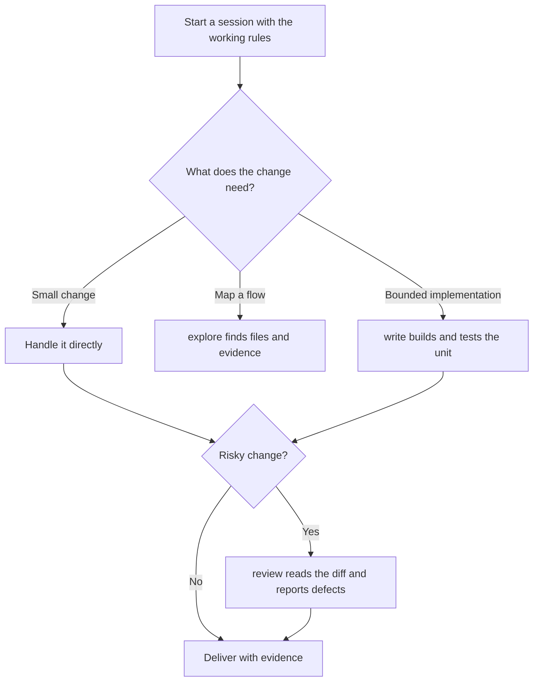

# playbook-agents

A way of working for building software with an AI coding agent: working rules the agent follows in every project, three agents to delegate to, and four skills. It is the agent system of [playbook](https://github.com/andresfrei/playbook)'s author, shared for whoever wants it.

It needs `playbook-wiki`, the core of playbook, which keeps a project's definitions and decisions in a wiki inside the repository. Installing this plugin from its marketplace installs `playbook-wiki` with it; if `claude plugin list` does not show `playbook-wiki`, install it too.

## Agent flow



## What it holds

| Part | What it does |
|------|--------------|
| [rules.md](rules.md) | The working rules: how the agent talks to you, decides, builds, delegates, and delivers |
| `explore` | An agent that maps where something lives across many files, without changing them |
| `write` | An agent that builds one bounded unit of work with its tests |
| `review` | An agent that reads a risky change in a separate context and returns findings |
| `keep-minimal` | Keeps an implementation the simplest one that solves the current problem |
| `review-change` | Reviews a change, a diff, or a commit for defects before it is merged |
| `write-skill` | Writes or audits a skill in a fixed format and within size limits |
| `avoid-generic-design` | Keeps out the generic look AI tools give a page or an interface by default |

Claude Code takes its models and reasoning effort from [models.conf](models.conf). The [Codex guide](../../codex/README.md) lists the corresponding Codex profiles.

## Hooks

At session start the plugin loads [the working rules](rules.md). Claude Code also loads the language preference when configured. When the review agent finishes, a hook records it for the session. Before a code commit, another hook can hold the first attempt and show the changed paths so the agent can assess risk. Wiki-only commits go through the wiki plugin's check. See the [hook definitions](hooks/hooks.json).

## Examples

```text
Review this diff before I merge it.
```

```text
Write a skill that prepares the release notes of this repository.
```

```text
Review the landing page in src/pages/index.tsx for a generic AI look.
```

## Install

From this repository's marketplace, in Claude Code:

```sh
claude plugin marketplace add andresfrei/playbook
claude plugin install playbook-agents@playbook --scope user
```

See the [Claude Code guide](../../docs/claude-code.md) for the wizard and supporting tools. In [Codex CLI](../../codex/README.md), choose **wiki and agents**.

## Support

Report a problem or propose a change in the [repository's issues](https://github.com/andresfrei/playbook/issues). Report a vulnerability as [SECURITY.md](https://github.com/andresfrei/playbook/blob/main/SECURITY.md) says.

## Licence

MIT, as [LICENSE](https://github.com/andresfrei/playbook/blob/main/LICENSE) says.
