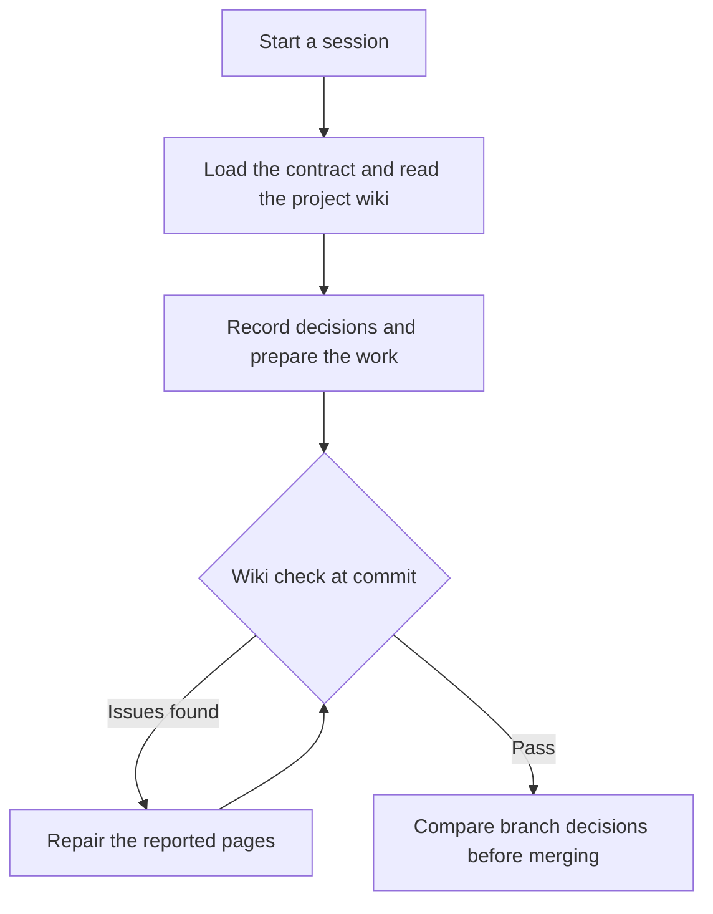

# playbook-wiki

Keeps a project's definitions and decisions in a wiki inside the project's repository, `docs/wiki/`, so every person and every agent on the project works from the same source of truth. Before any code, a piece of work is defined and decided with you, one stage at a time; the wiki records who decided what, in their own words.

It is the core of [playbook](https://github.com/andresfrei/playbook) and works on its own with your existing agent setup. The format of a wiki is in [format.md](format.md).

## Wiki flow



## What it holds

| Part | What it does |
|------|--------------|
| `prepare-project` | Prepares a new project, phase, or feature in six stages, from the wiki to the plan and its execution. You close each stage, unless you delegated that. When a work closes, it proposes delegating the kinds of question you keep accepting as recommended, and asks no question a delegation in force covers. At the close, when your project has `docs/wiki/evidence.md`, it proposes turning repeated findings of `review` into a rule, which you approve, or the agent makes when you delegated the kind `consolidate` |
| `write-docs` | Writes a README, a guide, or a wiki page that a reader understands without the conversation that produced it |
| `init` | Adds only a wiki's skeleton to a repository that has none, such as an old project or someone else's: the entry point with the project's owner, the format marker, and, if you agree, two sentences in `CLAUDE.md`. It opens no work. Only you start it: `/playbook-wiki:init` |
| `doctor` | Brings a wiki written in an earlier format to the present one. Only you start it: `/playbook-wiki:doctor` |
| `check-wiki.sh` | Checks that a wiki follows the format. With `--delegations`, prints each kind of decision you accepted as recommended at least 10 times, at least 80% of the time, and never rejected |

## Claude Code hooks

Each hook prints a file of this folder with `cat`, or runs a POSIX shell script of it that uses only `sh`, `sed`, `awk`, and `git`. None of them connects to a network, and nothing leaves your machine.

| When | What it reads | What it does |
|------|---------------|--------------|
| A session starts | [contract.md](contract.md) | Prints the contract: the rules an agent follows in a project with a wiki |
| A new session starts | `docs/wiki/.format` of the session's project | When the wiki's format is behind the plugin's, shows you one line recommending `/playbook-wiki:doctor`, and tells the agent; when it is ahead, which means the plugin is older than the wiki, shows you one line recommending an update. Prints nothing otherwise |
| A new session starts | The installed plugin's manifest, and the same plugin's manifest in the marketplace's copy on your machine, under `~/.claude/plugins/marketplaces/` | When the copy holds a newer version, shows you one line with both versions and how to update, and tells the agent. It never updates anything and does not check online, so it sees a new version only after the marketplace is refreshed. A marketplace from a local folder runs the plugin from the folder, so it shows nothing. Prints nothing otherwise |
| A subagent starts | [contract.md](contract.md) | Gives the same contract to the subagent |
| Before a Bash command that runs `git commit` | The command, and `docs/wiki/` of that repository | When the wiki is at the present format and differs from the last commit, runs `check-wiki.sh`. When the check fails, the commit is stopped and the agent gets the check's output to repair. Prints nothing otherwise. A commit you run in your own terminal is not touched |
| Before a Bash command that runs `git merge` | The command, and `docs/wiki/` on both branches | When each side added decisions since they diverged, or both changed the same shared page, asks you before the merge, showing the list. Prints nothing otherwise |

The hooks change no file and no setting. The contract is text the agent reads at the start of each session, in every project where the plugin is on; the format and version notices show you one line when there is something to do, and tell the agent too.

## Examples

```text
Start a new feature: roles and permissions for the admin panel.
```

```text
Write the README of the billing module.
```

```text
/playbook-wiki:init
```

```text
/playbook-wiki:doctor
```

## Install

From this repository's marketplace, in Claude Code:

```sh
claude plugin marketplace add andresfrei/playbook
claude plugin install playbook-wiki@playbook --scope user
```

For setup through the wizard, see the [Claude Code guide](../../docs/claude-code.md). In [Codex CLI](../../codex/README.md), choose **wiki only** to use this plugin on its own.

## Support

Report a problem or propose a change in the [repository's issues](https://github.com/andresfrei/playbook/issues). Report a vulnerability as [SECURITY.md](https://github.com/andresfrei/playbook/blob/main/SECURITY.md) says.

## Licence

MIT, as [LICENSE](https://github.com/andresfrei/playbook/blob/main/LICENSE) says.
