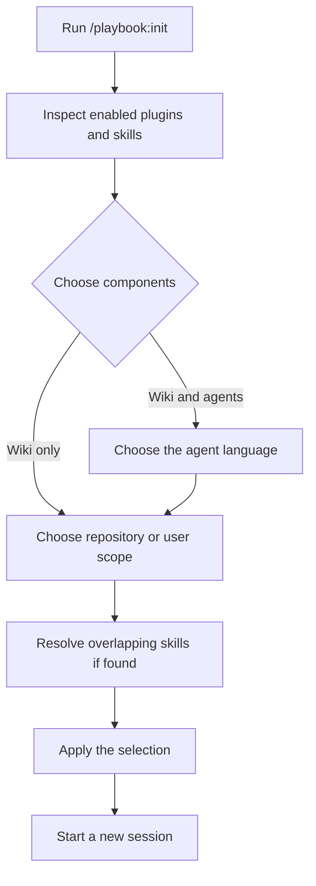

# playbook

This optional setup plugin gives Claude Code the `/playbook:init` command. Use it to choose what runs in a single repository or across your projects. You can also install the wiki directly. Codex offers its own [installer](../../codex/README.md).

## Setup flow

Run the command again to change your selection. See the [Claude Code guide](../../docs/claude-code.md) for installation and the [init skill](skills/init/SKILL.md) for the exact prompts and settings.
