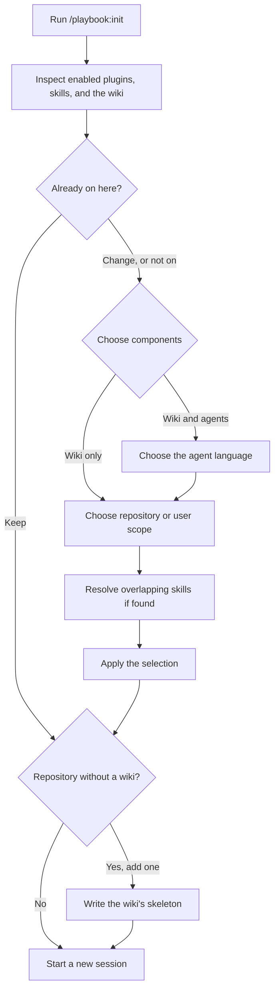

# playbook

This optional setup plugin gives Claude Code the `/playbook:init` command. Use it to choose what runs in a single repository or across your projects. You can also install the wiki directly. Codex offers its own [installer](../../codex/README.md).

## Setup flow

Run the command again to see what is on and keep it or change it. A pair of skills you settled with "Keep both" is not asked again: the choice is kept under `playbook.keepBoth` in your Claude Code settings. See the [Claude Code guide](../../docs/claude-code.md) for installation and the [init skill](skills/init/SKILL.md) for the exact prompts and settings.
